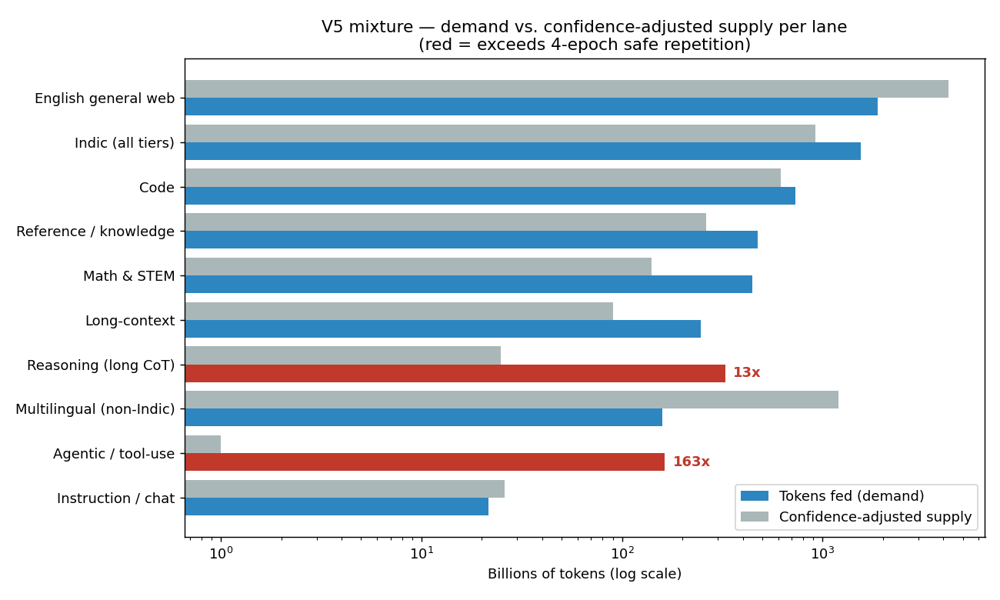
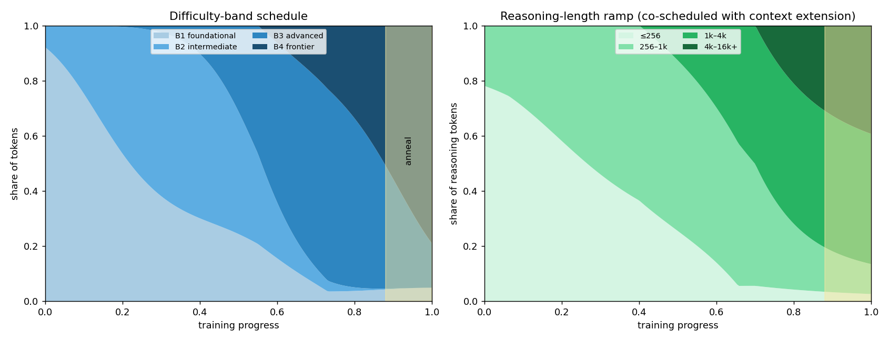
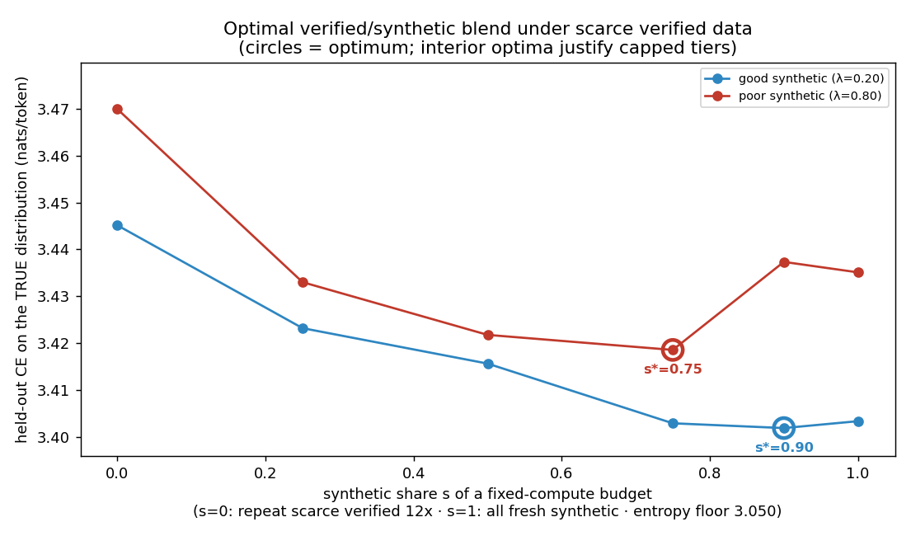

# V5 Data Mixture & Curriculum Plan — India-first 40B

**A testable specification for the V5 pre-training mixture.** Every share below is a
hypothesis with a supply number behind it and a proxy experiment in front of it. The
plan is deliberately short: it commits to numbers, says where those numbers are backed
by real data and where they are not, and names the single 1B/3B experiment that would
confirm or refute the headline mixture before a rupee of full-scale compute is spent.

> **One-line thesis.** For a 40B India-first model the binding constraint is *not*
> compute — it is the ~100B tokens of genuinely verified Indic text that exist in the
> world. The mixture is built around that fact: it gives Indic a large, defended share,
> then states honestly that most of that share is unverified, translated or synthetic,
> and it redirects the cleaning effort at the one slot the accounting proves is starved.

---

## 0. Design constraints

| Parameter | Value | Why |
|---|---|---|
| Model | 40B dense, India-first | Fixed by the V5 brief |
| **Total token budget** | **6.0T tokens** (≈150 tokens/param) | Inference-optimal over-training for a production model, bounded by a realistic Indian-lab compute budget. Below frontier over-training (Llama-3-70B ≈ 15T) on purpose. **All shares are expressed as %, so the plan re-scales if the budget is set to 4T or 10T.** |
| Stable phase | 5.28T (88%) | Bulk learning under near-constant LR |
| **Anneal reserve** | **0.72T (12%)** held back | High-quality cooldown injection (§6) |
| Repetition ceiling | **4 epochs** | Beyond ~4 epochs repeated data adds ≈0 (Muennighoff et al. 2023); our own tier-blend probe (§8.1) independently finds pure-repetition the worst of every option tested. Used as the hard test for "wishful" shares. |
| Supply-confidence discount | raw × confidence factor | Raw dataset sizes overstate supply because near-duplication is pervasive; epochs are computed against confidence-adjusted supply, with retention fractions in the ~0.5–0.85 range typical of MinHash/SemDedup passes (§1). |
| **Tokenizer** | Indic-optimized, target avg fertility ≤ ~2.0 (Hindi ≈ English parity) | Generic tokenizers cost 4–8 tokens/word for Indic vs ~1.4 for English; the tokenizer is the single biggest lever on Indic budget, compute, and inference cost. All token counts below assume this tokenizer (§2.1). |

Everything downstream is checked against one rule: **a lane's share, multiplied by the
budget, must not demand more than 4 epochs of the lane's confidence-adjusted supply — and if it
does, the plan must say so and say what it will do about it.**

---

## 1. The mixture (headline table)

Shares are given for the stable phase and the anneal reserve separately, because they are
scheduled differently; the "Effective %" column folds them into a share of the full 6T and
is what the supply accounting uses. Each lane is tied to the benchmark it is meant to move.

Supply is reported as **confidence-adjusted supply** = raw inventory size × the fraction that survives
cross-corpus near-dedup and quality filtering. That discount is not decorative: near-
duplication is pervasive on web crawl, and MinHash/SemDedup-class passes (Lee et al. 2022;
the FineWeb report) typically retain only ~0.5–0.8 of raw crawl tokens, so raw dataset sizes
overstate real supply. Epochs are therefore computed against confidence-adjusted supply, not
raw. The factors here are conservative planning assumptions; the tool that *measures* them per
lane at assembly, [`supply_audit.py`](proxy/supply_audit.py), is built and validated to ±0.004
(§8.2). Full per-lane fractions are in [`proxy/results/lane_ledger.md`](proxy/results/lane_ledger.md).

| Lane | Stable % | Anneal % | **Eff. % of 6T** | Tokens fed | Conf-adj supply (raw) | Epochs | Target benchmarks |
|---|--:|--:|--:|--:|--:|--:|---|
| English general web | 34 | 12 | **31.4** | 1.88T | 4.25T (5T) | 0.44 | MMLU, HellaSwag, ARC-C |
| **Indic (4 tiers)** | 26 | 24 | **25.8** | 1.55T | 921B (1.25T) | 1.68 | MILU, IndicGenBench, IndicXTREME |
| Code | 12 | 14 | **12.2** | 734B | 620B (775B) | 1.18 | HumanEval, MBPP |
| Reference / knowledge | 9 | 0 | **7.9** | 475B | 262B (350B) | 1.81 | MMLU, TriviaQA, GPQA |
| Math & STEM | 6 | 18 | **7.4** | 446B | 140B (200B) | 3.19 | GSM8K, MATH |
| Reasoning (long CoT) | 4 | 16 | **5.4** | 326B | 25B (45B) | **13.2 ⚠️** | MATH-500, GPQA-diamond |
| Long-context | 4 | 5 | **4.1** | 247B | 90B (150B) | 2.75 | RULER, LongBench |
| Multilingual (non-Indic) | 3 | 0 | **2.6** | 158B | 1.2T (2T) | 0.13 | Flores, XNLI |
| Agentic / tool-use | 2 | 8 | **2.7** | 163B | 1B (2B) | **163 ⚠️** | BFCL v3, τ-bench |
| Instruction / chat | 0 | 3 | **0.4** | 22B | 26B (40B) | 0.83 | IFEval, MT-Bench |
| **Total** | **100** | **100** | **100.0** | **6.0T** | — | — | — |



**Two lanes are flagged wishful by the accounting, and the plan owns both (§4):** the
reasoning (13× the confidence-adjusted supply) and agentic (163×) lanes ask for far more tokens than any
real corpus can supply, so they are declared synthetic-first, not pretend-real. Every other
whole lane sits under the 4-epoch ceiling — but inside the Indic lane, the **verified tier
crosses it at 6.0 epochs** once the supply-confidence discount is applied (§2), which is the single most
important number in this plan.

**Why these numbers, defended briefly.**
English stays the largest single lane at 31% because it is the substrate reasoning and
world-knowledge transfer are learned on; an India-first model that is weak in English
reasoning loses on MMLU/GPQA and, worse, transfers that weakness into Indic. Indic is the
differentiator at 25.8% — larger, per token, than any general-web lab would spend, and
directly precedented: Sarvam-1 (2B) reached ~2T Indic tokens, so ~1.55T for a 40B is
supply-reachable, *provided* we are honest that most of it is not verified (§3). Code at
12% is load-bearing for reasoning, not just for HumanEval, and its confidence-adjusted supply (~620B of
The Stack v2 dedup after further filtering) sits close to demand at ~1.2 epochs. Math and reasoning are
small in the stable phase and heavily up-weighted in the anneal, where high-quality traces
have outsized effect. Agentic and long-context are small by supply necessity, not by
preference.

---

## 2. The Indic lane — the 4-tier split, accounted honestly

The Indic lane feeds **1.55T tokens (25.8% of the budget)**. Hiding that behind a single
headline number would be exactly the wishful accounting this plan exists to prevent, so it
is split across the four tiers, each with its own real supply and epoch count.

Supply is again confidence-adjusted (raw × confidence factor); the steepest discount falls on
the web-crawled unverified tier, where near-duplication is heaviest.

| Tier | Share of Indic | Tokens fed | Conf-adj supply (raw · conf) | Epochs | Primary sources |
|---|--:|--:|--:|--:|---|
| **Verified** | 28% | 433B | 72B (103B · 0.70) | **6.00 ⚠️** | Sangraha-Verified (64.3B) + IndicCorp v2 (~21B) + Indic Wikipedia / curated news, gov, textbooks (~18B) |
| **Unverified** | 24% | 371B | 240B (400B · 0.60) | 1.55 | Sangraha-Unverified (24.3B) + Indic FineWeb-2 / CulturaX / MADLAD / HPLT |
| **Translated** | 22% | 340B | 289B (340B · 0.85) | 1.18 | EN→Indic MT of high-quality English (textbooks, FineWeb-Edu, reasoning traces) |
| **Synthetic** | 26% | 402B | 322B (402B · 0.80) | 1.25 | Sangraha-Synthetic (162.7B; translated-wiki + romanized) + model-generated Indic QA / CoT / code-switched |

**The one number a reviewer should push on, and the honest answer.** Verified Indic is the
binding constraint of the entire model. Only ~64B verified tokens exist in the largest
curated corpus (Sangraha-Verified); adding IndicCorp v2, Indic Wikipedia and curated
sources brings the raw pool to ~103B, and after cross-source dedup only **~72B is truly
unique**. To give verified Indic 433B tokens we would therefore run it at **6.0 epochs —
clearly past the safe ceiling.** The plan does not pretend otherwise: it treats 6.0 as a
*deficit to be closed by cleaning*, not an acceptable operating point. It is also *why the
budget is 6T and not 12T*: at 12T the verified tier would need ~12 epochs, which is
indefensible. **Verified Indic supply, not GPU count, is what caps V5.** The cleaning
program (§9) is pointed straight at this: promote cleaned unverified text through the
verification pipeline to grow the usable pool from ~72B toward **~108B (raw ~155B)**, which
brings verified back to the 4-epoch ceiling; the empirical justification for treating 4
epochs as the line is in §8.1.

Note the supply-confidence discount *worsens* verified from a comfortable-looking 4.2 to a
can't-ignore-it 6.0 — this is the whole point of the discount: it stops the plan from hiding
a real deficit behind a raw dataset-card number.

The translated and synthetic tiers are *not* supply-constrained — you can always translate
or generate more — so their caps (22% and 26%) are set by **quality risk, not scarcity**:
translated text carries MT artifacts and factual drift, and synthetic text risks
distributional collapse. Both caps are hypotheses that arm **A2** of the proxy (§7) is
designed to test: if replacing the synthetic tier with more repeated verified does *not*
hurt held-out Indic quality, the synthetic tier is refuted and its budget moves to
verified/unverified.

### 2.1 The Indic token tax (tokenizer fertility)

Every token count above hides a second cost that a reviewer will rightly push on: **an Indic
token is worth less than an English one**, because Indic scripts fragment into far more
subword tokens per word. Under a generic tokenizer the tax is severe.

| Tokenizer | English | Hindi | Tamil | Malayalam | Oriya |
|---|--:|--:|--:|--:|--:|
| Llama-4 (generic) | ~1.4 | 1.83 | 5.87 | 4.95 | **10.51** |
| Gemma-3 | ~1.3 | 1.47 | 2.50 | 3.45 | — |
| Indic-optimized (IndicSuperTokenizer / Sarvam-1) | ~1.4 | **1.23–1.4** | **2.1** | **2.3** | 1.65 |

*Fertility = tokens per word; lower is better. Generic multilingual tokenizers need 4–8
tokens/word for many Indic scripts vs ~1.4 for English; an optimized tokenizer brings this to
~1.2–2.3 (≈39% better average fertility than Llama-4, and ~1.4–2.1 across languages for
Sarvam-1).*

This tax lands in four places, so it is a first-order design variable, not a detail:

- **Budget/content.** Because Indic fertility exceeds English even after optimization, the
  25.8% *token* share buys a smaller *content* share. Rough content-equivalents at the
  fertilities we assume: English 1.88T tok ÷ 1.4 ≈ **1.34T words**; Indic 1.55T tok ÷ ~2.0 ≈
  **0.78T words**. So in content terms Indic is ~37% of what English gets despite being 82%
  of it in tokens — which reframes 25.8% as a serious-but-not-wasteful commitment, and shows
  we could not reach content-parity even if we wanted to, because supply won't allow it.
- **Compute.** Training FLOPs scale with tokens, not words, so a high fertility means paying
  more compute per unit of Indic knowledge. Moving from a generic tokenizer (~4×) to an
  optimized one (~2×) roughly halves the effective Indic compute bill — a larger saving than
  any lane-share tweak.
- **Inference / product.** An India-first model emits Indic at inference, where the tax
  becomes latency and cost; the optimized tokenizer reports ~44% higher throughput (Sarvam-1
  cites 4–6× faster inference vs generic-tokenizer models). For a deployed product this is
  decisive.
- **Context.** Indic eats the context window faster, so the long-context lane's *effective*
  reach in Indic is shorter unless fertility is controlled.

**Decisions this forces, and they are already in the plan:** (1) V5 commits to an
Indic-optimized tokenizer with a target **average fertility ≤ ~2.0 and Hindi near English
parity** (the §0 constraint); (2) all token counts in this plan are stated *with respect to
that tokenizer* — a caveat, since dataset-card token counts use their own tokenizers, so the
supply figures are re-derived under ours at assembly time (a readiness-gate item, §11);
(3) the supply-confidence discount and the token tax are independent multipliers on the same
raw text, and the reconciler keeps them separate so neither hides the other.

---

## 3. The three named lanes: agentic, reasoning, long-context

The brief asks these three to be named explicitly and pointed at datasets. They are also
the three where honest supply accounting hurts the most, so each states plainly how it is
filled.

**Agentic / tool-use — 2.7% (163B tokens), declared ~95% synthetic.**
Datasets: xLAM-function-calling-60k, Glaive-function-calling-v2, ToolBench, APIGen-MT,
ToolMind, Nemotron post-training tool traces. Real supply is ~2B raw tokens (≈1B after the
supply-confidence discount) — the accounting says the naive plan would repeat that usable
pool **~163×**, which is absurd. So the lane is redefined: the ~2B raw real traces are *seed*
data used to bootstrap synthetic generators (sampled tool schemas → LLM-generated multi-step
calls → execution-verified where an executor exists → dedup + quality filter). The lane's
headline is therefore "163B tokens, of which ≤2B raw real (≈1B usable), ≥161B
generated-and-verified." Whether this synthetic lane actually moves BFCL is exactly what
proxy arm **A3** tests; if 2.7% synthetic does not beat 0.5%, the lane is cut to its floor
and the budget goes to code and reasoning.

**Reasoning (long CoT) — 5.4% (326B tokens), synthetic-first.**
Datasets: OpenThoughts3, OpenR1-Math-220k, Nemotron reasoning traces, plus distilled CoT
from a strong teacher on math/code/science prompts (including Indic-language prompts).
Confidence-adjusted supply is ~25B tokens → **13× repetition**, well over the ceiling. The lane is
filled by generating fresh distilled traces rather than re-reading the same ~25B thirteen
times, with strict dedup and answer-verification (keep a trace only if its final answer is
correct). Concentrated in the anneal (16% of the reserve), where reasoning data pays off
most.

**Long-context — 4.1% (247B tokens).**
Datasets: native long documents (books, arXiv, legal/government PDFs, repo-level code),
plus constructed long-context tasks (multi-doc QA, summarization, key-value retrieval).
Confidence-adjusted supply of *genuinely* long documents is ~90B (2.75 epochs), and part of that overlaps
other lanes — the same book counts in "reference" and "long-context" — so this lane is
scheduled as a **context-length curriculum**, not a separate corpus: train at 4k–8k early,
extend to 32k then 128k in a dedicated phase co-located with the anneal, re-packing
existing high-quality documents into long sequences. Target: RULER at 32k/128k, not just
needle-in-a-haystack at 4k.

---

## 4. Protected always-on floor (the selector may not cross)

V5 uses a dynamic data selector (online domain re-weighting in the DoReMi / RegMix family)
that adjusts lane shares during training toward a proxy validation loss. A selector
optimizes what it can measure, and it will happily starve a lane whose payoff is
long-horizon or invisible to the proxy — Indic and agentic are the obvious victims. The
floor encodes the strategic priorities the selector cannot see. **At every step the
instantaneous mixture must satisfy:**

| Floor | Minimum instantaneous share | Rationale |
|---|--:|---|
| Indic (all tiers) | **≥ 18%** | Protect the India-first mission from an English-greedy selector |
| Indic **verified** | **≥ 5%** of total | Never let the highest-value tier be zeroed out |
| English general web | ≥ 22% | Protect the reasoning/knowledge substrate |
| Code | ≥ 7% | Cheap to lose, expensive to relearn; load-bearing for reasoning |
| Math + Reasoning (combined) | ≥ 6% | Prevent CoT capability collapse mid-run |
| Long-context | ≥ 2% (once extension begins) | Keep long-range attention alive |

These floors sum to ~60% of the budget, leaving the selector ~40% of headroom to
optimize freely. Proxy arm **A5** (floor on vs off) measures what the floor costs on
general benchmarks and what it saves on Indic/agentic — the floor is itself a hypothesis.

---

## 5. Anneal reserve (the cooldown)

**12% of the budget — 0.72T tokens — is held back** for the final LR-decay phase, where
data quality has outsized, well-documented impact (Llama-3, OLMo-2, MiniCPM). The reserve
is skewed hard toward the highest-signal data:

| Anneal component | Share of reserve | Tokens |
|---|--:|--:|
| Verified/high-quality Indic (incl. Indic instruction & CoT) | 24% | 173B |
| Math & STEM (competition, verified) | 18% | 130B |
| Reasoning (distilled, answer-verified long CoT) | 16% | 115B |
| Code (with unit tests / execution-verified) | 14% | 101B |
| English high-quality (textbooks, FineWeb-Edu top decile) | 12% | 86B |
| Agentic / tool-use (verified traces) | 8% | 58B |
| Long-context tasks | 5% | 36B |
| Instruction / multi-turn chat | 3% | 22B |

The anneal is where Indic verified is spent most intensively and where the reasoning-length
and difficulty curricula reach their frontier bands (§6).

---

## 6. Difficulty and reasoning-length bands

Curriculum is applied along two independent axes. Each band below has a concrete worked
example; the schedule (front-load easy/short, ramp hard/long into mid-training and the
anneal) is shown in the figure.



### Difficulty bands

| Band | When | Concrete example |
|---|---|---|
| **B1 Foundational** | Front-loaded, tapers | *EN:* "The capital of France is Paris." · *Hindi:* "भारत की राजधानी नई दिल्ली है।" · *Math:* "3 pens cost ₹12, so 1 pen costs ₹4." |
| **B2 Intermediate** | Peaks ~35% through | *"A shop sells 3 pens for ₹12. Ravi buys 5 pens and pays with a ₹100 note. How much change does he get?"* (2–3 step word problem, GSM8K-class) |
| **B3 Advanced** | Peaks ~70% through | *"Find all real x with x⁴ − 5x² + 4 = 0 and prove the set is complete."* · or a multi-hop Indic reading-comprehension item requiring inference across a passage |
| **B4 Frontier** | Ramps late + anneal | *GPQA-diamond:* graduate-level physics/chemistry · *olympiad math* · *multi-tool agentic task:* "Using the flights and calendar APIs, book the cheapest itinerary that lands before the 9 a.m. meeting." |

### Reasoning-length bands (co-scheduled with context-length extension)

| Band | CoT length | Concrete example |
|---|---|---|
| **Short** | ≤256 tok | *"2 + 2×3 = ?"* → "Multiply first: 2×3 = 6; then 6 + 2 = 8." |
| **Medium** | 256–1k tok | A standard ~5-step GSM8K solution with each arithmetic step written out. |
| **Long** | 1k–4k tok | A MATH proof with case analysis, or an agentic trace of 3–4 tool calls with intermediate reasoning. |
| **Extra-long** | 4k–16k+ tok | A competition problem solved with explicit exploration and backtracking, or long-context multi-document synthesis. Requires the 32k/128k context phase, so it lives almost entirely in the anneal. |

**Why ramp rather than mix uniformly.** Over-weighting extra-long CoT early wastes budget
and teaches the model to pad; front-loading foundational/short builds stable
representations cheaply; frontier/extra-long land in the anneal where they convert best.
Proxy arm **A4** ablates the ramp against a uniform mix to confirm it is worth the
scheduling complexity.

---

## 7. The proxy plan — nothing here is trusted until 1B/3B says so

**A data decision is a hypothesis until a cheap experiment tests it.** No share above is
trusted at 40B until it survives proxy runs at 1B and 3B that use the *same* tokenizer,
mixing engine and floor code path as the full run.

**Arms with pre-registered decision rules** (1B first, promote finalists to 3B). Each arm
names the metric, the threshold that *confirms* it, and the action taken if it is *refuted* —
pre-registered so the result cannot be rationalised after the fact.

| Arm | Metric (vs A0) | Confirm if | Action if refuted |
|---|---|---|---|
| **A0 Baseline** | — (reference) | — | — |
| **A1 Indic +5%** (from English) | Indic aggregate ↑, MMLU Δ | Indic aggregate **+≥1.5 pt** at 1B **and** MMLU **≥ −0.7 pt** | keep Indic at 26%; do not raise |
| **A2 Verified-only vs +Synthetic** | Indic held-out quality (not just NLL) | +synthetic **≥ +1.0 pt** over verified-repeat on MILU | cut synthetic tier, move budget to verified/unverified |
| **A3 Agentic 2.7% vs 0.5%** | BFCL v3 | 2.7% beats 0.5% by **≥ 3 pt** BFCL | cut agentic to its 0.5% floor; budget → code+reasoning |
| **A4 Curriculum ramp on/off** | GSM8K + MATH-500 mean | ramp beats uniform by **≥ 1.0 pt** at equal tokens | drop the ramp; use uniform difficulty/length |
| **A5 Floor on/off** | Indic aggregate & agentic BFCL vs MMLU | floor costs MMLU **≤ 0.5 pt** while holding Indic/agentic **≥ 2 pt** above the no-floor run | re-tune floor levels, do not remove |

**Compute.** 1B arms trained to ~30B tokens (~Chinchilla), 3B finalists to ~90–120B tokens.
Total proxy cost is a low-single-digit % of the 40B run — the whole point. All thresholds are
stated at the 1B screen; a finalist must **hold its sign and margin at 3B** (below) to be
promoted.

**Metrics.** English: MMLU, HellaSwag, ARC-C. Indic: MILU, IndicGenBench, IndicXTREME, and
per-language held-out NLL on a frozen verified-Indic validation set. Code: HumanEval, MBPP.
Math/Reasoning: GSM8K, MATH-500, GPQA-diamond subset. Agentic: BFCL v3 subset. Long-context:
RULER at 4k/8k. Plus per-lane held-out validation loss for the scaling-law check.

**The single confirm/refute metric for the headline mixture.** *Primary endpoint:* the
**Indic aggregate** (mean of MILU and IndicGenBench) at 3B. *Guardrail:* English MMLU as a
non-inferiority bound. **The mixture is confirmed and promoted to 40B iff, at 3B, the Indic
aggregate beats an English-heavy control by ≥ 3 points while English MMLU regresses by
≤ 1.0 point, and no protected lane falls below its floor-performance.** Otherwise it is
refuted and re-tuned.

**Scaling-law gate.** For each lane, fit held-out loss vs. share at 1B and 3B; require the
gradient sign to be consistent across both scales before extrapolating to 40B. A share
whose effect flips sign between 1B and 3B is *not* trusted at 40B — it goes back to the
bench.

---

## 8. Proxy results — the cheap experiments, actually run

The 1B/3B GPU runs are the next step, but **three cheaper experiments are run here and now**,
because they are the cheapest things that can refute the plan — and they already do.

### 8.0 Budget reconciliation

The reconciler turns every share into a demand for confidence-adjusted supply tokens and flags anything
past the 4-epoch ceiling. Reproduce with:

```bash
cd proxy && python3 budget_reconciler.py   # writes results/*.md and results/*.png
```

Output (see [`proxy/results/lane_ledger.md`](proxy/results/lane_ledger.md) and
[`proxy/results/indic_tier_ledger.md`](proxy/results/indic_tier_ledger.md)):

- Effective lane shares sum to exactly 100% of 6T (assertion-checked).
- **Reasoning** demands 13× its confidence-adjusted supply (~25B) → flagged, redefined as synthetic-first.
- **Agentic** demands 163× its confidence-adjusted supply (~1B) → flagged, redefined as ~95% synthetic.
- **Indic verified** demands 6.0 epochs on ~72B confidence-adjusted supply → the binding constraint;
  drives the cleaning target.
- Every other whole lane sits under 4 epochs.

### 8.1 Tier-blend probe — why the Indic tiers are *capped*, and where

The plan's hardest claim is not "repeat less" — it is that, given a scarce verified pool, the
right answer is a *bounded blend* of verified and lower-quality (synthetic/translated)
tokens: neither pure-verified-repeated nor pure-synthetic. We test this directly on a
controlled, offline, deterministic language (an order-2 Markov process with a known entropy
floor). We hold **compute fixed**, keep the verified pool **scarce**, and sweep the synthetic
share `s` of the budget — so `s`=0 fills the budget by repeating scarce verified, `s`=1
trains only on fresh synthetic, and in between is a blend. We do this for a *good* synthetic
generator and a *poor* one (a quality-gap knob λ), then score held-out loss on the **true**
distribution. Reproduce with:

```bash
cd proxy && python3 tier_blend_probe.py   # ~90s CPU, seed 0, no network
```



| Synthetic share s | Verified repetition | Good-synth CE (λ=0.20) | Poor-synth CE (λ=0.80) |
|--:|--:|--:|--:|
| 0.00 (repeat verified) | 12× | 3.445 | 3.470 |
| 0.25 | 9× | 3.423 | 3.433 |
| 0.50 | 6× | 3.416 | 3.422 |
| 0.75 | 3× | 3.403 | **3.419 ←** |
| 0.90 | 1.2× | **3.402 ←** | 3.437 |
| 1.00 (all synthetic) | 0× | 3.403 | 3.435 |

**Three results, each load-bearing for the plan:**

1. **Pure-repetition (s=0) is the worst option in both regimes** — repeating scarce verified
   12× to fill the budget loses to every blend. This is the empirical basis for treating
   verified Indic's 6.0-epoch demand as a *deficit to close by cleaning*, not an operating
   point, and it corroborates the 4-epoch ceiling from a second angle.
2. **The optimum is interior** — a bounded blend beats going all-in on any single tier. That
   is exactly why the Indic lane is split into four *capped* tiers rather than bet on one.
3. **The optimal synthetic share moves with quality:** s\*=0.90 when synthetic is good vs
   s\*=0.75 when it is poor, and poor synthetic actively *hurts* past its cap (the red curve
   turns up). This is why the plan sets tier caps by **quality risk**, and why proxy arm A2
   (verified-only vs +synthetic) is the gate that fixes the real Indic caps at 1B/3B scale.

Full write-up: [`proxy/results/tier_blend_results.md`](proxy/results/tier_blend_results.md).

*Caveat (stated, not hidden):* a ~22k-parameter toy far below 40B; the exact optima are
regime-dependent. It is offered as directional evidence for the *unrun* 1B/3B arms, not as
the final caps — those are confirmed at scale by A2.

### 8.2 Supply-confidence auditor — the instrument is validated

The confidence factors in §1 are planning assumptions until measured on real shards. So the
measuring instrument itself is built and validated now:
[`supply_audit.py`](proxy/supply_audit.py) computes a lane's confidence factor
(usable-unique-in-language ÷ raw) via a language-ID gate, exact-dedup, and MinHash+LSH
near-dedup. Run against a corpus with a **known** usable fraction of **0.615** (exact copies,
near-copies and out-of-language junk injected at controlled rates), it recovers **0.619 —
absolute error 0.004**. An instrument validated against ground truth is one whose numbers are
defensible when it is later pointed at the real Sangraha / FineWeb-2 / Stack-v2 shards; doing
so per lane is the concrete step that closes the data-gating gap (§11). Reproduce:

```bash
cd proxy && python3 supply_audit.py   # ~5s, seed 0, no network
```

All three experiments are the model of the GPU proxy: they are re-run after each cleaning
milestone (as confidence-adjusted supply grows) and after each 1B/3B arm (as measured
per-lane value comes in), and no share is frozen for the 40B run until reconciler, probe,
auditor, and the 3B endpoint all agree.

---

## 9. What this implies for cleaning (the starved slots)

The mixture is only as trustworthy as the cleaned tokens behind it, and the accounting
names precisely which slots are starved, so cleaning is redirected there rather than spread
evenly:

1. **Verified Indic (highest priority).** Grow the *confidence-adjusted supply* verified pool from ~72B
   toward **~108B (raw ~155B)** by running cleaned unverified/crawled Indic text through the
   verification pipeline, which brings verified from 6.0 epochs back to the 4-epoch ceiling.
   Concrete quality gates the pipeline enforces: **language-ID confidence ≥ 0.90** per
   document (fastText/CLD3-class scorer), a **near-duplicate cluster policy** that keeps one
   exemplar per MinHash/SemDedup cluster, a quality-classifier threshold, and toxicity/PII
   filtering. Each promotion is re-scored by the reconciler so the epoch number is always
   current, not aspirational.
2. **Reasoning & agentic seed quality.** These lanes are synthetic-first, so cleaning shifts
   to the *generators and their seeds*: deduplicate and answer-verify generated traces,
   filter collapsed/degenerate outputs, and keep an execution check for tool-use. The unit
   of cleaning here is "verified-correct synthetic trace," not "crawled document."
3. **Math & STEM.** Second-tier priority (2.2 epochs) — extend by cleaning Nemotron-CC-Math
   and OpenWebMath-class sources and by translating high-quality math into Indic (feeds both
   the math lane and the Indic translated tier).

The cumulative cleaning target is set against these three, in this order.

---

## 10. Risks and what would refute this plan

- **Synthetic Indic collapse.** If arm A2 shows the synthetic tier does not help held-out
  *quality* (only perplexity), cut synthetic and shift budget to verified/unverified.
- **Translation drift.** MT artifacts could teach unnatural Indic; mitigated by capping the
  translated tier at 22% and monitoring native-fluency evals, refutable via A0-vs-A1 error
  analysis.
- **Agentic lane not worth it.** If A3 shows 2.7% synthetic agentic ≈ 0.5%, the lane is a
  waste; cut to floor.
- **Budget sensitivity.** Even at 6T the verified-Indic tier is already at 6.0 epochs after
  the supply-confidence discount; at 10T it would be ~10 epochs. The plan therefore *depends on* the
  cleaning program closing the verified deficit, or on a smaller verified share. This is
  stated, not hidden.

---

## 11. Data-gating & readiness

The brief reviews a plan only once the team has met the **data-gating threshold**, because a
mixture is only as trustworthy as the cleaned, documented tokens behind it. Being honest
about where this plan sits on that gate:

- **What is real here:** the supply figures are grounded in published inventory (Sangraha's
  tier sizes, The Stack v2 dedup, IndicCorp v2, Nemotron-CC-Math, etc.), discounted by a
  supply-confidence factor whose retention range follows published MinHash/SemDedup-class
  results. The three experiments in §8 are actually run and reproducible — including the
  supply-confidence auditor (§8.2), the very tool that measures the gate.
- **What is modelled, not yet measured:** the confidence factors for lanes we have not yet
  audited are labelled planning assumptions, and the per-lane raw sizes come from dataset
  cards, not from our own token counts over the assembled corpus.
- **The gate is no longer just a promise — the instrument exists.** `supply_audit.py` is
  built and validated to ±0.004 against a known-truth corpus (§8.2), so measuring the real
  factors is now a matter of running it over the shards, not of inventing a method.
- **Gate to "ready":** the plan moves from *modelled* to *gated-ready* when (1) each lane's
  confidence-adjusted supply is re-derived by running `supply_audit.py` over the actual
  assembled shards (not cards) and **re-counted under the V5 tokenizer** (so Indic token
  figures reflect our real fertility, §2.1), (2) the verified-Indic pool is cleaned to ≥108B
  usable, and (3) the reasoning and agentic generators have produced a first dedup+verified
  batch large enough to price their lanes empirically. Until then, every share in §1 is
  explicitly a *hypothesis under test*, which is exactly how the reconciler and the A-arms
  treat it.

This section exists so a reviewer is never misled into reading a modelled supply number as a
measured one.

---

## 12. Repository layout / reproduce

```
.
├── README.md                       # this plan
└── proxy/
    ├── budget_reconciler.py        # experiment #1: shares -> demand -> confidence-adjusted supply -> epochs -> flags
    ├── tier_blend_probe.py         # experiment #2: optimal verified/synthetic blend under scarce verified
    ├── supply_audit.py             # experiment #3: the confidence-factor auditor, validated to ±0.004
    └── results/
        ├── lane_ledger.md          # per-lane demand vs confidence-adjusted supply (auto-generated)
        ├── indic_tier_ledger.md    # Indic 4-tier accounting (auto-generated)
        ├── tier_blend_results.md   # blend-sweep table + takeaway (auto-generated)
        ├── supply_audit.md         # auditor validation report (auto-generated)
        ├── lane_headroom.png       # figure in §1
        ├── curriculum_ramps.png    # figure in §6
        └── tier_blend_curve.png    # figure in §8.1
```

```bash
python3 proxy/budget_reconciler.py   # reconciliation + figures
python3 proxy/tier_blend_probe.py    # tier-blend study + figure (~90s, no network)
python3 proxy/supply_audit.py        # confidence-factor auditor validation (~5s, no network)
```

---

## 13. Sources for the supply numbers

- Sangraha (AI4Bharat) — 251.3B tokens (Verified 64.3B, Synthetic 162.7B, Unverified 24.3B), 22 languages: https://huggingface.co/datasets/ai4bharat/sangraha
- IndicCorp v2 (AI4Bharat): https://huggingface.co/datasets/ai4bharat/IndicCorpV2
- Sarvam-1 — ~2T Indic tokens for a 2B model, synthetic-heavy (precedent for Indic supply reachability): https://www.sarvam.ai/blogs/sarvam-1
- The Stack v2 / StarCoder2 — dedup ~775B tokens, 67.5TB, 600+ languages: https://arxiv.org/abs/2402.19173
- FineWeb / FineWeb-Edu — 15T / 1.3T–5.4T tokens: https://huggingface.co/datasets/HuggingFaceFW/fineweb
- Nemotron-CC-Math — 133B-token math pre-training set: https://arxiv.org/abs/2508.15096
- xLAM function-calling-60k (agentic seed): https://huggingface.co/datasets/Salesforce/xlam-function-calling-60k
- OpenThoughts (reasoning data recipes): https://arxiv.org/abs/2506.04178
- Repetition ceiling — Muennighoff et al., "Scaling Data-Constrained Language Models" (2023): https://arxiv.org/abs/2305.16264
- Deduplication retention — Lee et al., "Deduplicating Training Data Makes Language Models Better" (2022): https://arxiv.org/abs/2107.06499
- Near-dedup method — Broder, "On the resemblance and containment of documents" (MinHash, 1997): https://doi.org/10.1109/SEQUEN.1997.666900
- Indic tokenizer fertility — IndicSuperTokenizer (Hindi 1.23, Tamil 2.12, Malayalam 2.30; +39.5% vs Llama-4; +44% inference throughput): https://arxiv.org/html/2511.03237v1
- Indic tokenizer fertility — Sarvam-1 (generic 4–8 tokens/word for Indic vs 1.4 English; Sarvam tokenizer 1.4–2.1; 4–6× faster inference): https://www.sarvam.ai/blogs/sarvam-1
